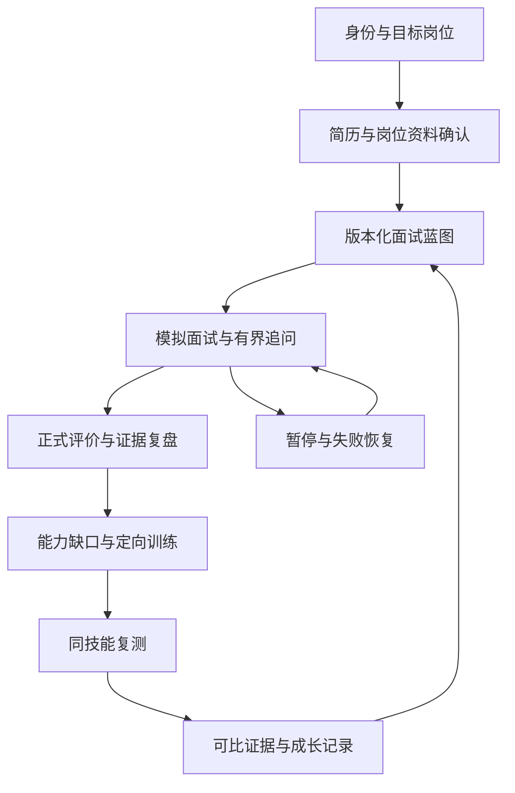
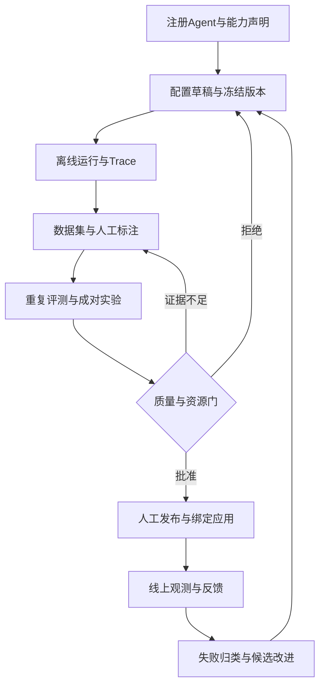
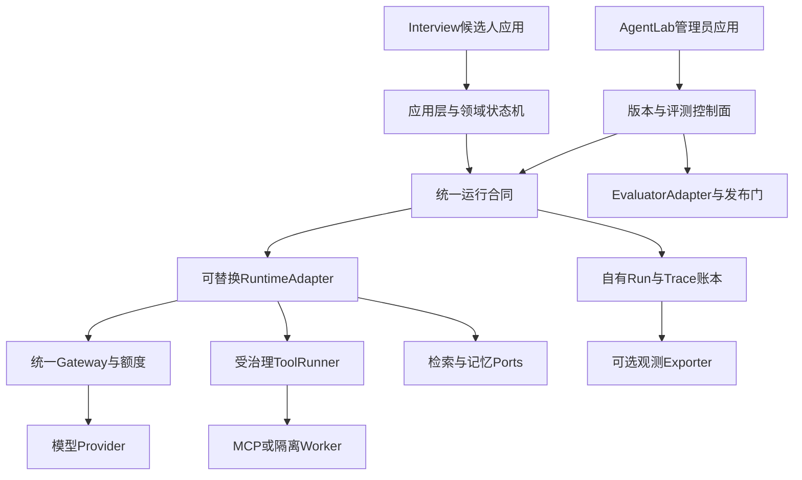

# 自建可替换 AgentLab 与 Interview 完整功能规划

更新：2026-10-19。选择依据：用户明确选择“全自建可替换架构”。这是目标设计和增量交付合同；功能只有匹配代码、真实 API/持久化与浏览器证据后才算交付。整体产品仍 NOT_ACCEPTED。当前实现状态以 CURRENT_STATE 和逐项验收台账为准。

## 证据原则

用户2026-10-19明确要求：必须以代码为准，不许简略推断和瞎编。现状必须定位当前代码、实际入口与数据流；源码阅读、实测通过、未知/阻塞、目标设计分别陈述。规划表和官方产品声明不证明本项目已经实现或接通；没有运行的测试、部署、真实模型与费用结果不得补写为成功。本文件中的目标状态、端口和批次均为设计，不是实现验收证据。

## 1. 产品定位与优先级

构建两个独立应用，共享受治理的后端能力：

- **Interview**：面向技术岗位候选人的准备、模拟、复盘、训练、复测产品。
- **AgentLab**：管理 Agent/工作流/知识与工具绑定、运行、追踪、评测、改进、发布和回滚的控制面。

近期成果首先服务开源、真实自用与工程能力展示。个人/组织隔离、可恢复性和成本控制保留产品化标准；支付、团队账单、ATS 和招聘筛选不作为当前训练产品的默认前置。

自建领域模型、状态机、评测证据和发布决策。模型、运行引擎、索引、评测器与观测出口通过明确适配器替换。没有启用商业账号、购买套餐、接收私有题库或宣称对第三方完成真实集成。

## 2. 最新商业能力对标与采用方式

核对日期为本文件更新日；以下是官方可见功能，不是全市场排名、价格承诺、独立效果验证或公开 API 可用性保证。供应商更改接口时需重新核验 SDK/API、版本、许可、地区、数据流和配额。

| 官方产品 | 可核实能力 | 本项目采用的产品原则 | 接入边界 |
| --- | --- | --- | --- |
| [LangSmith Evaluation](https://docs.langchain.com/langsmith/evaluation-types) | 离线/在线评测、规则/模型/成对评分等；[人工反馈](https://www.langchain.com/langsmith/evaluation) | 评测在开发、发布和生产形成循环；模型评分需人工校准 | 自建数据集/评测合同；未来可选导出/镜像结果，不委托外部服务决定发布 |
| [Langfuse Evaluation](https://langfuse.com/docs/evaluation/overview) | 数据集实验、线上Trace评分、人工标注及CI实验；[离线SDK入口](https://langfuse.com/docs/evaluation/get-started/offline) | 使用同一应用代码路径做离线实验，Trace回流用例 | 复用现有可选Langfuse出口；新SDK需单独迁移，不因官网更新直接升级锁文件 |
| [Braintrust Datasets](https://www.braintrust.dev/docs/guides/datasets)与[Agent Evaluation](https://www.braintrust.dev/learn/ai-agent-evaluation/v0) | 数据集版本、Trace/步骤评分、逐样本实验差异 | 版本化输入、分层失败分析、逐样本而非仅总分比较 | 规范化交换格式；以后可接自愿导出，不把外部ID作为领域主键 |
| [CodeSignal AI Interviewer](https://codesignal.com/ai-interviewer/) | 岗位技能结构、追问、证据报告与人工决策；[AI协作编码](https://codesignal.com/blog/introducing-ai-assisted-coding-assessments-interviews/) | 岗位Rubric、追问依据、允许AI协作的练习模式需显式区分 | 参考流程；招聘筛选、公平性和合规认证不能直接继承为本项目结论 |
| [HackerRank Screen](https://www.hackerrank.com/products/screen) | JD关联测评、技术任务、AI使用边界和报告 | 题目贴近工程任务，清楚区分独立作答与允许AI辅助 | 编码执行依赖隔离沙箱；暂不复制商业题库/监考能力 |
| [interviewing.io](https://interviewing.io/) | 真人模拟、编码/系统设计AI模拟及反馈 | 模拟后给出可行动反馈，复测验证改进；保留专家复核入口 | 训练产品对标，不假定存在可调用的外部面试API |
| [Yoodli Interview Preparation](https://yoodli.ai/use-cases/interview-preparation) | 对话模拟、动态追问和个性化沟通反馈 | 技术内容与表达反馈分开，语音为可选模态 | 先完成文本黄金链；没有真实音频时不推算口语指标 |

工程模式参考：[LangGraph工作流与Agent](https://docs.langchain.com/oss/javascript/langgraph/workflows-agents)、[持久化](https://docs.langchain.com/oss/javascript/langgraph/persistence)、[中断与人工参与](https://docs.langchain.com/oss/javascript/langgraph/interrupts)。采用稳定业务状态机包围有界Agent决策，按需调度专业角色；不要求每轮固定运行所有Agent。官方新特性不代表当前锁定版本已具备。

## 3. 当前事实与目标差距

| 领域 | 已有代码资产 | 目前不能宣称的能力 | 目标增量 |
| --- | --- | --- | --- |
| Interview | 岗位/简历/SSE/正式证据/报告/训练与复测合同 | 完整真实模型黄金链、已验证学习提升 | 全链逐状态验收、可靠恢复、同技能可比复测 |
| 运行时 | LangGraph；single-agent-v1与finite-workflow-v1；版本/预算/Trace | 任意自主工具Agent、并行循环平台 | RuntimeAdapter能力注册，受控工具执行与可取消任务 |
| 配置绑定 | 工具/知识/记忆字段有合同校验 | 已接通这些绑定：当前非空绑定被拒绝 | 首个只读知识工具走ToolRunner，逐类开放能力 |
| 工具治理 | ToolRunner、审批、预算、Guard；Registry即时禁用检查 | 所有历史执行路径均进入ToolRunner | 从一个真实工具贯穿治理入口，然后逐工具迁移 |
| 版本接入 | Application/Run与legacy-sse-bridge；已发布policy可注入 | 全会话已固定版本、Lab故障不影响策略完整性 | 每回合记录和policy同源固定；再升级会话快照与必需策略加载 |
| Agent评测 | 冻结集、审查、重复评测、费用约束、发布CAS | 已校准语义评分、全自动可靠改进 | EvaluatorAdapter、人工标注、Judge校准、盲测/保留集 |
| 队列/恢复 | PostgreSQL持久任务、租约、取消边界 | 独立Worker/沙箱/崩溃精确结算 | 达到必要规模后分离执行进程；未知费用人工对账 |
| 商业扩展 | 用户/组织/额度/账本基础 | 完整订阅/支付/发票/企业招聘服务 | 作为后续边界设计，不阻塞当前核心交付 |

### 3.1 源码核对入口

本轮基于main合并PR43后的源码及本轮待提交改动核对；本轮实现的最终身份以PR精确head为准。以下文件/符号是现状依据，不以类名或文档猜测功能：

| 现状结论 | 实际文件/符号 |
| --- | --- |
| 配置型运行只支持single/finite且拒绝非空工具/知识/记忆绑定 | `apps/api/src/modules/agent-lab/configured-runtime.contract.ts` 的运行合同校验 |
| Runtime按字符串选择实现，尚未完成通用替换 | `apps/api/src/modules/agent-lab/agent-runtime.service.ts` 的 `runAgent` / `prepareConfiguredRun` |
| 规则评分而非已校准语义评分 | 同模块 `evaluation.service.ts` 的 `evaluateRule`，KEYWORD/JSON_SCHEMA/延迟分支 |
| 历史工具真实执行入口并未全部经过ToolRunner | `apps/api/src/agents/multi-agent/nodes/executor.ts` 调用 `McpRegistry.get(...).execute(...)`；`tool-runner.service.ts` 为另一独立入口 |
| Interview仍用可选桥，失败后继续旧流程 | `application.service.ts` 的legacy-sse-bridge配置；`interview-flow.controller.ts` 的startTurn及catch分支 |
| 回合版本同源与确认回执为本轮新增 | `interview-lab-bridge.service.ts/startTurn`；`apps/web/src/pages/InterviewPage.tsx/confirmResumeStart`；对应测试及本轮验收记录 |

未在本轮重跑的业务链保持未核实。历史资产存在与本轮质量通过分别记录，不给未定义的完成度百分比。

## 4. 完整 Interview 业务链

### 4.1 输入与准备

1. 注册/登录、组织与数据用途确认；用户可以查看当前用量、退出和撤销会话。
2. 创建目标岗位、职级、JD；保存岗位版本和必需技能权重。支持文本JD的现有路径；文件/URL解析按未来能力逐步开放。
3. 上传合成或用户明确提交的简历，校验格式/大小、提取事实并展示可修正摘要。确认必须有后端成功回执；网络/拒绝/回执不明不解锁面试。
4. 岗位知识与简历引用分离；所有检索来源有所有者、版本/时间和权限标签。缺资料允许明确的非个性化练习，不伪装为已读取简历。
5. 面试蓝图固定岗位版本、简历版本/指纹、技能范围、难度、题目类型、帮助模式、回合/Token/费用/时限、Rubric和Agent发布快照。

### 4.2 模拟与练习模式

| 模式 | 目标 | 帮助边界 | 结果 |
| --- | --- | --- | --- |
| 完整模拟 | 测量当前表现 | 默认不展示答案；澄清不泄露评分参考 | 完整报告/证据 |
| 单技能练习 | 改善一个证据缺口 | 可给逐级提示，明确记录提示次数 | 练习反馈/完成记录，不自动提高正式分 |
| 项目/系统设计 | 检查取舍、架构与故障排查 | 按Rubric追问，引用用户项目事实 | 分维度证据与改进任务 |
| AI协作编码（后续） | 测量使用AI解决工程任务 | 事先声明允许范围，保留协作记录 | 代码测试/过程证据；不与独立作答分数直接混比 |
| 语音模拟（后续） | 表达与技术沟通 | STT/TTS独立预算与同意，保留文本降级 | 技术与表达指标分开 |

### 4.3 运行与恢复合同

状态机的目标状态为 PREPARING / READY / IN_PROGRESS / PAUSED / EVALUATING / COMPLETED / FAILED / CANCELLED；采用显式映射逐步兼容当前数据库状态，不能只重命名枚举。

- 服务端决定合法动作；模型仅在授权动作集合内建议下一题、澄清或追问。
- 一个回答关联稳定questionId、answerId、turnId和requestKey。重复提交复用结果，内容变更使用新键；相同键不同输入409。
- SSE目标事件为 accepted / question / delta / turn.completed / evaluation.pending / error。事件包含版本、runId、turnId、单调序号；候选人看不到内部Prompt、原始工具结果或隐私数据。
- 当前仅有完成回复重放；event offset/保留窗口/断点续传属于独立迁移，不把checkpoint当网络续传。
- 超时/断网/Provider错误展示明确状态和恢复入口。已发付费调用结果未知时先查询Run/账本，不自动重新发起。
- 发布只影响新快照；既有面试应持续使用已绑定快照。当前回合级一致性修复不等于全会话锁定已实现。

### 4.4 报告、训练与成长

正式报告引用不可变EvaluationRun与证据；包括问题、实际回答、Rubric维度、得分依据、缺失信息、置信度、引用和建议。无证据返回unknown，不造“0分”。

训练任务引用具体缺口及来源运行，包含目标、解释、练习、完成标准和复测入口。完成训练只保存Attempt。复测使用可比技能/难度/Rubric/岗位版本；不满足可比性只展示两次结果，不能绘制虚假增长率。不能承诺Offer预测。

## 5. 完整 AgentLab 研发与发布链

### 5.1 必备功能面

| 模块 | 功能合同 | 关键退出门 |
| --- | --- | --- |
| Registry | Agent身份、所有者、草稿、不可变版本、依赖指纹、发布/回滚 | 版本变更不覆盖历史Run；跨组织拒绝 |
| Builder | 运行类型、输入/输出Schema、节点/边、工具/知识/记忆绑定、预算与能力限制 | 不支持的能力显式拒绝；预览不冒充执行 |
| Runtime | 受控模型调用/有界Agent/有限工作流；Run/Step/子Run | requestKey、租约、取消、结果归属和恢复一致 |
| Tools | 工具Schema、作用范围、审批、执行Guard、调用前校验、回执 | 禁用阻断后续调用；未知副作用不自动重试 |
| Knowledge | Source/Document/Chunk、版本、检索权限、去重、删除、质量 | 删除/更新可读回；旧16题须确认归属再迁入 |
| Memory | 会话记忆、长期事实/偏好、来源、有效期和删除 | 跨用户不读写；推测不写成已验证事实 |
| Trace | 真实节点、结构化事件、模型/工具/检索/费用、导出 | 事件追加、脱敏、未知字段不伪造 |
| Datasets | 线上失败收集、去敏、分层采样、标注、版本、冻结与审核 | 训练/开发/保留集隔离；来源许可与删除可追踪 |
| Evaluators | 规则、模型Judge、人工、成对/轨迹/会话级评分 | 评测器自身版本/校准、错误与弃权语义 |
| Experiments | 同集/同条件、多次重复、逐样本差异、切片、统计区间 | 拒绝不兼容比较、少样本不宣称提升 |
| Improvement | 失败分类→候选Prompt/检索/工具/工作流改动→实验 | 候选不得覆盖当前正式版或修改自己的分数 |
| Release | 审查、质量/安全/成本/延迟门、CAS发布、审计、回滚 | 录制结果不解锁真实发布；版本变化需重新核门 |
| Operations | 用量/账本/价格来源、保留策略、权限、服务健康 | 未知账单非零；重载/重启/实例范围准确 |

### 5.2 评测分层

**产品评价**衡量候选人在目标岗位下的表现；**工程评测**衡量Agent版本是否可靠。两者引用不同定义和运行身份，不互相写分。

| 层级 | 主要指标 | 首选评分来源 |
| --- | --- | --- |
| 输出合同 | Schema、完整性、合法状态、答案泄露 | 确定性规则 |
| 业务结果 | 岗位相关、技术正确、问题难度、追问有效、可行动反馈 | 人工标注+经校准Judge |
| 检索 | Recall@k、相关性、Grounding、引用精度 | 标注查询集+检索证据 |
| 工具/轨迹 | 选择正确、参数合法、审批、次数、真实结果 | 规则+固定轨迹/模拟工具 |
| 会话 | 跨轮一致性、重复问题、完成率、记忆隔离 | 多轮固定场景+人工抽检 |
| 资源 | p50/p95、模型调用、Tokens、工具次数、已知/未知费用 | Gateway/UsageLedger/Trace |
| 学习效果 | 同技能可比复测、证据增长、完成与回访 | 正式证据与长期产品观测 |

Judge必须版本化模型/Prompt/Rubric，盲化候选名称、交换成对顺序、多样本复核和记录弃权。与人工差异及置信度达到预先定义标准后，才参与发布门；质量阈值通过冻结的门配置设置，不伪造通用“90分合格”。输入文本和检索数据都不能改变评测指令。

线上评测先抽样/异步，失败候选经去敏与人工准入进入新数据集版本。外部评分导入必须标记external/recorded/synthetic；不允许外部webhook直接设置PUBLISHED。

## 6. 目标架构与稳定模式

具体边界与迁移见 [可替换架构合同](../architecture/REPLACEABLE_AGENT_CONTRACTS.md)。保持一个NestJS模块化单体与两套独立前端；先建立服务接口/依赖注入，不先拆微服务。

- 业务生命周期是确定性工作流；开放问题的局部决策可用有界Agent。
- 默认按需使用Interviewer、Evaluator、Knowledge Curator、Training Coach角色，优先复用同一运行协议。不是每次对话固定启动四个模型。
- 状态持久化、网络重放、任务领取、付费结算分别有合同；checkpoint本身不能承诺Exactly-once外部副作用。
- 可观察结构化决定、证据与实际动作，不采集或展示隐藏思维链。
- 工具/知识能力通过显式allowlist、schema、权限与预算启用。适配器替换必须通过同一合同套件，不降级租户隔离、审批或费用证据。

## 7. 数据与API演进

复用User/Organization/Workspace/Agent/AgentVersion/Application/Run/Trace/Evaluation/Usage及Interview正式证据。先检查现有表与唯一索引，再做必要的加性迁移；目标模型名不等于需要立即创建同名新表。

后续需要设计：Interview会话的发布快照、ResumeVersion、Rubric版本、标注任务/分歧、评测器manifest、绑定资产指纹、外部引用映射、投递收据与删除传播。删除策略覆盖原始数据、索引、长期记忆和外部副本。

现有`/api`保持兼容；新增合同带schemaVersion。任务统一返回202+jobId+查询/取消地址，能力列表只声明实际支持项。新路径必须验证真实Controller/状态机，不能仅按规划创建空API或假成功。

## 8. 完整验收与专家团

每个批次由产品/架构、开发、安全、独立测试分别负责；开发者不能自己签全部验收。

1. 产品合同：前置、角色/组织、输入、输出、单位、状态、失败恢复、预算。
2. 开发验证：类型、Lint、单元、真实PG/Redis/向量合同、迁移兼容。
3. 独立双证据：API/持久化读回与真实浏览器展示/交互分开核对。
4. Agent质量：冻结集、人工基准、Judge校准、真实模型对比与资源账本；fixture只验证工程。
5. 交付：精确SHA、配置/镜像digest、新旧库迁移、备份恢复、远端CI、文档和回滚。

模板数不能作为覆盖率。沿用986条源码台账并展开空/单/多、并发、失败/恢复、键盘与1440/768/390状态；范围内未知或失败不得签通过。

真实模型仍遵守已有单次≤0.5CNY、发布前累计≤3CNY约束；历史未知费用与额度未核前不付费重放。外部服务付费、账号权限和用户数据导出须有对应授权。

## 9. 分批落地与依赖

| 批次 | 范围 | 完成门 | 依赖 |
| --- | --- | --- | --- |
| B0 当前可靠性 | MCP调用前禁用、范围/恢复；简历确认回执；回合版本一致性 | 回归/独立评审/新镜像CI；明确当前限制 | 现有运行链 |
| B1 替换合同 | RuntimeAdapter能力注册、ApplicationAdapter、统一结构化事件；包装现有引擎 | 两实现同合同、未知适配器拒绝、旧链兼容、错误隔离 | B0 |
| B2 工具与知识 | 首个只读知识工具贯穿ToolRunner；预算/审批/来源；再记忆绑定 | 从真实入口执行、Trace/账本/权限、禁用/取消/失败测试 | B1 |
| B3 Interview黄金链 | 会话快照、面试蓝图、可靠恢复、正式报告→训练→复测 | 完整API/浏览器链、版本切换和跨租户、历史不覆盖 | B1；知识增强依赖B2 |
| B4 可信评测 | EvaluatorAdapter、人工标注/Judge校准、分层/轨迹/会话评测、逐样本对比 | 开发/保留集隔离、错误/弃权、真实有界对比 | B1；真实费用门 |
| B5 受控改进 | 失败回流、候选生成、实验、审查、发布/回滚、线上抽样 | 改进不可自行发布或改分，CAS与回滚实测 | B3+B4 |
| B6 产品化扩展 | 独立Worker/沙箱、语音/编码、集成、账单/支付、小程序 | 按实际需求独立合同/预算/恢复/安全验收 | 核心链已接受；不并行堆全部能力 |

依赖图允许独立合同研究并行，发布按门推进。B0不是“全产品完成”；B6不作为2026年开源与面试作品的硬门槛。每个批次只引入可审查的一个主题，未完成项保持NOT_SHIPPED/BLOCKED/NOT_ACCEPTED。

## 10. 本轮具体交付与下一步

本轮提供官方对标、完整功能/流程、可替换架构合同与增量验收路线，同时修复已经复现的MCP执行边界、简历确认及回合版本一致性。后两项以对应提交与测试结果为准，文档计划本身不等于代码或平台接入。

下一完整开发主题：B1 RuntimeAdapter注册与兼容合同。B1通过后进入B2第一个受治理只读知识工具，随后补Interview会话级版本快照。Judge与训练效果不能靠关键词分数代验；在人工校准和预算核对完成前只实现离线合同测试。
